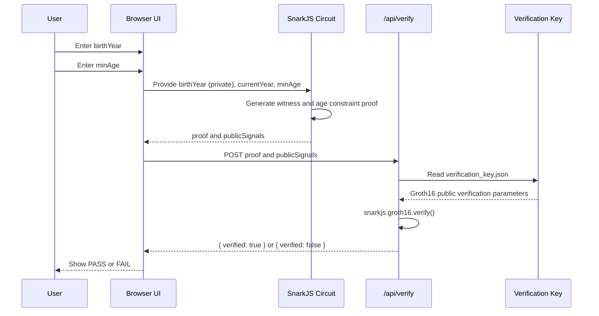

# ZKP Age Verification Portal

## Team

- Wajid — Circuits: Circom circuit design and constraint modeling
- Saad — Backend/API: Next.js verification route and server-side threat analysis
- Talha — Frontend/UI: Interactive Next.js interface and user workflow

## Abstract

The ZKP Age Verification Portal demonstrates privacy-preserving age eligibility checks. A user enters a birth year in the browser, the client supplies it as a private witness to a Circom arithmetic circuit, and the browser asks SnarkJS to generate a Groth16 zero-knowledge proof that the person's age is at least a chosen public minimum. The proof and public signals are sent to a Next.js API route. The server verifies them with the Groth16 verification key and returns a boolean result. It never receives the birth year directly.

Zero-knowledge cryptography is appropriate because the system needs to prove a property rather than disclose the underlying credential value. An ordinary API could send the birth year to the server and perform a normal comparison, but that creates an avoidable copy of sensitive personal information and increases the impact of server compromise or request logging. In contrast, a valid proof demonstrates that a hidden witness satisfies the circuit's constraints. The server learns the public year and minimum age and learns only whether verification succeeded. This is especially useful for an age gate, where the essential decision is often "eligible" or "not eligible," not "what is the exact birth year?"

The prototype is intentionally divided into three browser-visible steps: credential creation, proof generation, and verification. In demo mode, it can remain usable even before compiled circuit artifacts have been placed in the public circuit directory. In real mode, the browser executes a WASM witness generator and consumes a Groth16 proving key before sending the proof to the server.

## ZKP Background

A zero-knowledge proof system allows a prover to convince a verifier that a statement is true without revealing information that is not necessary for the statement. The statement in this project is: "There exists a birth year that is within the circuit's accepted range and produces an age greater than or equal to the public minimum age." The birth year is a private witness. The current year and minimum age are public inputs.

A proof system is expected to satisfy three important properties.

**Completeness** means that an honest prover using valid inputs can convince an honest verifier. Example: if the birth year is 2000, the current year is 2026, and the minimum age is 21, then 2026 minus 2000 equals 26, which is at least 21. If the circuit, witness, proving key, and verification key are consistent, proof generation and verification should succeed.

**Soundness** means that a dishonest prover should not be able to convince the verifier of a false statement, except with negligible cryptographic probability. Example: a user with no valid birth year satisfying a 21-year minimum should not generate a proof that verifies as a valid 21-or-older result. Soundness depends on the circuit constraints, trusted setup, cryptographic assumptions, and correct implementation.

**Zero-knowledge** means the verifier learns nothing about the hidden witness beyond the fact that the statement is true. Example: the server might see that an individual is over 21, while not receiving or deriving the actual birth year. Zero-knowledge is not a claim that every surrounding system becomes private. Metadata, network timing, public signals, browser code, and application logs can still reveal information.

Groth16 is a commonly used non-interactive proof system for arithmetic circuits. It is efficient in proof size and verification, making it suitable for a browser-to-server demo. Its trade-offs include a circuit-specific setup and the trusted setup requirement. Circom translates a readable circuit into arithmetic constraints, while SnarkJS provides witness generation, proof construction, proving-key operations, and verification.

## System Architecture

The application separates browser-side proof creation from server-side verification. The browser holds the private birth-year witness. Public signals are the values that the verifier is allowed to know and bind to the statement.

The browser UI is a three-step interface. Step 1 records a birth year as a private browser input. Step 2 records the public minimum-age input and attempts to generate a proof. Step 3 sends the proof and public signals to the API route and presents the result.

The API route accepts JSON containing `proof` and `publicSignals`. It does not accept or log `birthYear`. If the verification key file is unavailable, the route can run in demo mode. In that mode it returns a simulated success result and an explicit message indicating that no real cryptographic verification occurred. In normal operation, the key exists and SnarkJS verifies the proof before the route returns success or failure.

## Circuit Design

The `AgeVerify.circom` circuit is compiled with Circom 2.0 and intended for Groth16. It declares `birthYear` as private and `currentYear` and `minAge` as public signals. The circuit computes the age by subtracting birth year from current year:

`age = currentYear - birthYear`

The circuit then compares `age` with `minAge`. Circomlib's `LessThan(n)` component takes two inputs and returns a single signal. Mathematically, the component returns 1 when the first input is less than the second input and 0 when it is greater than or equal to the second input. The AgeVerify circuit constrains this output to 0, so a proof can only verify if `age >= minAge`.

The `LessThan` component encodes a comparison using arithmetic constraints. It is not a conventional JavaScript conditional. In a proving system, the output must correspond to constraints that every valid witness satisfies. If the comparison were used only as a browser-side `if` statement, the server would have no cryptographic assurance that the browser performed the check honestly.

The circuit also applies range and future-year checks. `Num2Bits(64)` decomposes the birth-year signal into 64 binary digits. This proves that the value is representable as a non-negative unsigned 64-bit number and prevents negative values from wrapping around in the finite field. A `LessThan(64)` check rejects birth years below 1900. A second comparison rejects a birth year later than the public current year. These constraints prevent absurdly old or future-dated values and help ensure that the computed age is meaningful.

Groth16 is a pairing-based proof system. It uses a quadratic arithmetic program derived from the circuit's rank-1 constraint system. The prover commits to the witness and produces proof elements, while the verifier uses public inputs and a public verification key. Groth16 proofs are compact and verification is relatively fast. These properties support a browser proof and server verification workflow.

The setup for Groth16 creates circuit-specific parameters. Powers of Tau contributes randomness and produces a public ceremony output. Phase 2 derives the proving and verification keys for the exact R1CS constraint system. The `.zkey` file contains proving parameters and must correspond to the compiled `.r1cs` and `.wasm` files. The verification key contains the public parameters needed by the server. It must match the circuit and proving key.

## Key Management

Trusted setup operations generate three families of artifacts. The Circom compiler produces the R1CS constraint system and WebAssembly witness generator. SnarkJS Powers of Tau and phase commands produce the proving key. The phase command exports `verification_key.json`.

The verification key belongs in the `keys/` directory. It should be publicly readable because it is not a secret. It contains the protocol and curve identifiers and the elliptic-curve points used during verification, including the alpha and beta elements, gamma, delta, and public-input scaling/commitment terms. The exact JSON shape follows SnarkJS export conventions.

The Next.js server should read `keys/verification_key.json` with `fs.readFileSync` or another server-only file API. The browser must not need a server copy at runtime. The verification route passes the JSON object, public signals, and proof to `snarkjs.groth16.verify`. Only a successful return value is converted into `{ verified: true }`. A false or malformed result produces a verification failure response.

The proving key is more operationally sensitive than the verification key. It should not be exposed as public web content unless the demonstration model deliberately permits browser proof generation. In a production design, the browser may receive or cache the WASM and zkey, but logs and server requests must not receive private witnesses. The trusted setup should use a multi-party ceremony where enough independent participants contribute randomness. Any participant who kept ceremony-related toxic waste could be in a dangerous situation if the setup were compromised. The verification key can still be pinned and checked so that applications use one known artifact set.

## Threat Model

### Malicious Server

An honest-but-curious server follows the protocol but may examine every value it receives. In this design, the server does not receive `birthYear`, only `proof` and `publicSignals`. It should not derive the hidden birth year from a valid proof. An honest-but-curious server could inspect IP addresses, browser timing, public age thresholds, and request frequencies, so request anonymity and metadata protection remain separate concerns.

A malicious server could alter application code, lie about verification results, replace the verification key, or add witness collection elsewhere. Zero-knowledge cryptography does not protect against a server that controls the browser page or JavaScript bundle. It also does not prevent a server from reporting `verified: false` even when verification succeeded or `verified: true` for an invalid result. Authentication, deployment integrity, HTTPS, and independent monitoring therefore remain important.

### Malicious User and Forged Proof

A malicious user may submit malformed JSON, invalid proof elements, proofs from another circuit, stale public signals, or arbitrary public values. The verifier must reject proofs that do not match the public signals or the key. A user cannot usually forge a valid proof of a false statement without solving the underlying cryptographic assumptions or obtaining a valid witness and proving key. A forged proof attempt should result in `verified: false`.

The server must not treat possession of proof data as proof of real-world identity by itself. A valid proof only proves that some witness satisfies the circuit constraints. It does not prove that the witness is truthful. The system needs a credential-issuance or identity trust mechanism if it is expected to prevent users from entering an entirely false birth year.

### Replay Attack

A replay attack copies a previously valid proof and reuses it. If the application does not bind proofs to the current year or an accepted request context, an old proof could possibly be replayed after its underlying statement should have changed. The public `currentYear` signal binds the statement to a year known to the server. The server must compare it with the real current year or a small approved policy window.

Additional replay defenses include short proof expiration, a random challenge or nonce, a session identifier, and binding proof data to an authorization transaction. A nonce is especially useful for one-time verification. Without it, Groth16 verification alone can validate the same statement each time it is replayed, while the application policy determines whether that reuse is acceptable.

### Side-Channel Risks

Proof generation in JavaScript or WebAssembly can leak timing or memory access data at the browser level. A compromised browser, extension, or operating system can read the private witness before proof generation. Network timestamps and request sizes can reveal that a user invoked the proof endpoint. Constant-time cryptographic operations in SnarkJS reduce local arithmetic concerns, but the application should still use HTTPS, avoid logging inputs, enforce size limits, rate-limit API requests, and monitor unusual traffic.

## Simulated Replay Attack

Consider a valid proof generated in 2026 for a birth year of 2005 and a minimum age of 21. The proof's public signals might contain `2026` and `21`. It validates in 2026 because the person is 21. An attacker copies the proof and associated public signals, then tries to use the same proof in 2030.

1. The attacker stores the original proof and public signal array.
2. In 2030, the attacker resubmits the proof unchanged.
3. The browser or application does not normally need to send `birthYear`; it sends public signals and the proof.
4. A server that ignores public signal freshness might still verify the cryptographic proof against the old 2026 context.
5. A sound application therefore checks the server's current year and whether `publicSignals[0]` equals the approved year.
6. If the proof says 2026 but the server requires 2030, it rejects or requires a newly generated proof.

Including `currentYear` in the public signal array prevents the proof from being a timeless statement about an arbitrary year. It also gives the server a policy value to compare. It does not add a cryptographically random one-time value; a user could replay the same 2026 proof several times within the same year. For strict one-time use, the server should add a nonce or session binding.

## Security and Usability Tradeoffs

The browser-side full proof workflow provides the strongest demonstration of privacy, but proof generation can be slower than a normal API call. Circom witness calculation and Groth16 proof generation in WASM can take seconds depending on the circuit size, browser CPU, memory, and device. The UI therefore uses a loading state and an explicit simulated fallback for missing circuit artifacts.

The compiled WASM witness generator and zkey add download and parsing costs. The application should serve them with appropriate cache headers and content types, and it should avoid lazy-loading unnecessarily large assets in the first render. Production deployments can evaluate code splitting, compression, content delivery, and artifact loading at the start of proof generation.

A trusted setup creates a deployment and governance burden. Groth16 is efficient, but a circuit change normally requires setup artifacts associated with the new constraint system. A different circuit or public signal layout may invalidate the existing `.r1cs`, `.wasm`, `.zkey`, and verification key. Production operation should pin all four artifact versions and verify their hashes.

Security and usability also trade off in public signal policy. A server can use a known `currentYear`, but this value may be supplied incorrectly or manipulated by a browser. The server should derive or validate the year rather than treating client input as an authoritative application policy. A minimum age is public because it is essential to interpreting the statement. This information is normally acceptable even though the birth year stays private.

## Deployment Notes

The Next.js application can be deployed to Vercel using the standard build and start workflow. The repository already provides `package.json` scripts for `npm run dev`, `npm run build`, and `npm run start`. Deployment should run a production build and verify that the API route executes on the Node.js runtime needed by `fs.readFileSync` and SnarkJS.

The `/keys/verification_key.json` file must be included in the deployment artifact. It should not be stored in a secret-only environment variable unless the deployment serializes the JSON correctly. Environment variables may be used for application settings such as API modes, deployment environment names, proof expiration windows, or allowed minimum ages. Private witness values must never be placed in environment variables or server logs.

Circuit WASM and zkey assets should be deployed under `public/circuits/` so the browser can fetch them. In this repository model, the relevant URLs are `/circuits/AgeVerify_js/AgeVerify.wasm` and `/circuits/AgeVerify_0001.zkey`. Vercel should serve these files with appropriate MIME types and allow large-file caching. The build pipeline should reject missing or mismatched circuit artifacts rather than silently returning a demo proof in production.

HTTPS is required for browser-to-server proof submission. The API route should limit payload size, reject malformed proof structures, and return generic error messages to avoid disclosing implementation details. Logs should record request outcomes, timestamps, and non-sensitive public signals, never birth-year witnesses.

## Limitations

The prototype proves eligibility according to a circuit, not the authenticity of the birth year. It could prove a false birth year if the user supplies one. It also cannot verify that the browser's JavaScript code is honest merely through Groth16 verification. If the browser is the prover and holds the secret witness, the server cannot independently establish that a user's real identity matches the witness.

The trusted setup requirement is another limitation for small educational deployments. A secure setup needs an accepted ceremony process and careful artifact management. The application should clearly label demo mode when compiled keys or the verification key are absent.

## References

1. Matthew Green. "A (Relatively Easy to Understand) Primer on Elliptic Curve Cryptography." Cryptographic engineering blog. https://blog.cryptographyengineering.com/2014/11/27/zero-knowledge-proofs-an-illustrated-primer/

2. Matthew Green. "Zero Knowledge Proofs: An illustrated primer." https://blog.cryptographyengineering.com/2014/11/27/zero-knowledge-proofs-an-illustrated-primer/

3. iden3. "snarkjs." GitHub repository. https://github.com/iden3/snarkjs

4. iden3. "Circom Documentation." https://docs.circom.io/

5. Groth, Jens. "On the Size of Pairing-Based Non-interactive Arguments." EUROCRYPT 2016. https://eprint.iacr.org/2016/260

6. Ben-Sasson, Eli, Alessandro Chiesa, Christina Garman, Matthew Green, Ian Miers, Eran Tromer, and Madars Virza. "Zerocash: Decentralized Anonymous Payments from Bitcoin." IEEE Symposium on Security and Privacy, 2014. https://ieeexplore.ieee.org/document/6956581

7. Goldwasser, Shafi, Silvio Micali, and Charles Rackoff. "The Knowledge Complexity of Interactive Proof Systems." SIAM Journal on Computing, 18(1), 1989. https://epubs.siam.org/doi/10.1137/0218012
